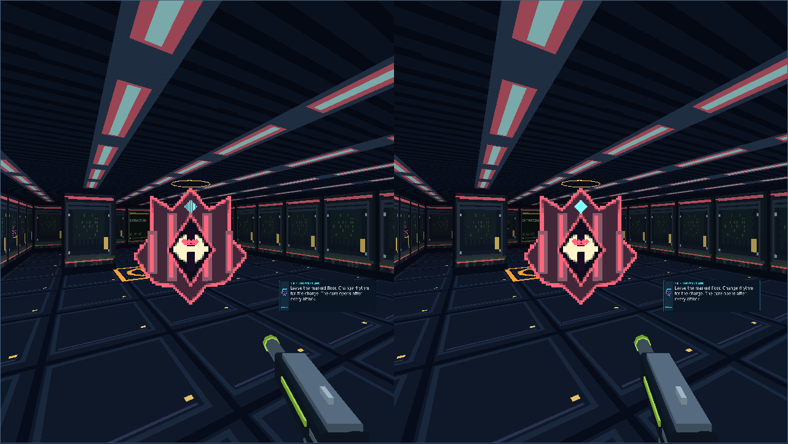
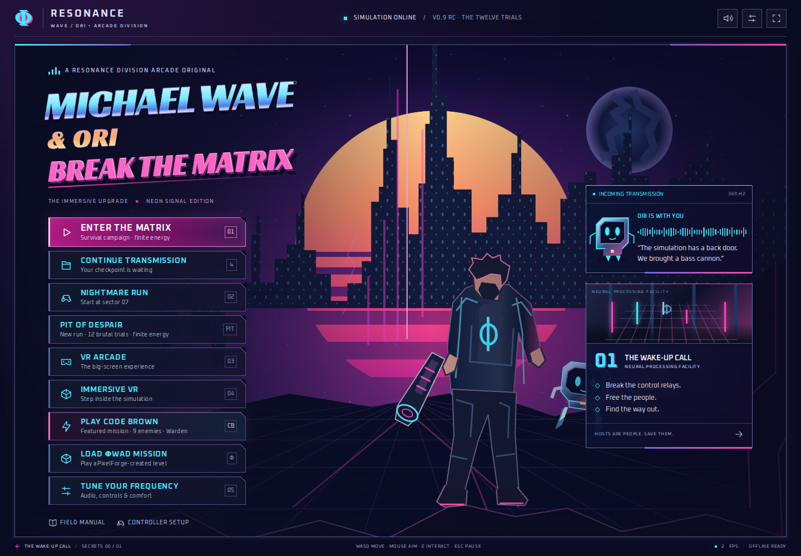

# PIT OF DESPAIR — The Twelve Trials

Candidate 0.9.0-rc.1 implements [Issue #9](https://github.com/MichaelWave369/BTM/issues/9) on main `89d9dc0795fd73e71176940721202091706a61c0` after PR #10. All twelve stages are authored and playable through the production simulation. This is an independent campaign, with its own menu, checkpoint slot and final ending. Nothing is merged or deployed by this work.

## Play and progression

Choose **PIT OF DESPAIR** for a new run or **CONTINUE THE DESCENT** to resume. Pit always uses Survival, even when the original campaign preference is Legacy. All six existing weapons are available; charge and reserve carry between trials. Relays and the key are free interactions. Major guardians must fall before their exits unlock. Captives, artifacts and ordinary enemy clearance are optional for extraction, so ammunition cannot permanently lock an objective.

| Act | Trials | Environmental identity | Encounter pressure |
| --- | --- | --- | --- |
| I · The Descent | 1 First Fall; 2 Starving Circuit; 3 Gatekeeper | Bronze intake, dry bus, brace chamber; amber/teal vent warnings; low exhaust pulse | Split approaches and cover, repeater crossfire, locked-direction ram |
| II · The Suffering | 4 Iron Lung; 5 False Sanctuary; 6 Static Tyrant | Pressure passages, looping refuge, Tesla throne; blue/red arcs; electrical cues | Flanking and predictive fire, denser mixed groups, marked floor and gap rings |
| III · The Fracture | 7 Shattered Choir; 8 Bloodless Grid; 9 Mirror Engine | Crossed galleries, surgical array, false cores; violet/cyan fracture marks; detuned tones | Crawlers and enforcers in crossed lanes, reflective guard, deceptive visual cores |
| IV · No Way Out | 10 Unlit Core; 11 Last Reservoir; 12 The Pit Itself | Black reactor, empty cisterns, final core; scarlet/gold void borders; sub-bass warning | Fastest predictive groups, widest hazard pressure, combined phased guardian attacks |

Each stage has a distinct carved traversal layout, cover pillars, encounter formations, named regions, wall archives and placed supplies. These are twelve separate cell maps, not renamed copies of original sectors. The same native Canvas and WebGL world renderers consume them. No new engine, CDN, runtime package, image asset pipeline or camera motion effect is introduced.

## Finite resources and fairness

Start with 100 charge and 45 reserve; capacities remain 100/180. Each non-boss trial contains five 45-unit reserve cells; boss trials contain seven. The cap leaves partial cells on the map. Reload takes 0.8 seconds and transfers existing reserve. There is no passive, relay, transition or retry ammunition grant. Each trial also has four health pickups, two armor pickups and one optional weapon-upgrade artifact. Carried health has a 40-point floor at trial entry; carried armor has no replenishment floor. Existing checkpoint retry preserves ammo/world state together and retains the inherited minimum 65 health.

Slap remains free. Ori, Dash Bash and the brief budgeted shield remain available without ammunition. Bosses expose after attacks; Ori and close-range pressure create openings without spending cells. An empty run is dangerous but does not require ammunition to break a relay, collect a key, open an exit or damage a guardian. Fixed finite supplies and act multipliers are implemented; human balance is still a tuning candidate. The automated driver has perfect map knowledge and aim and deliberately avoids timed floor zones. Its healthy finishes do not prove the campaign is hard enough for skilled humans.

## Four guardians

| Guardian | Identity and phases | Opening / counterplay |
| --- | --- | --- |
| Gatekeeper · trial 3 | Broad amber mechanical brace; locked ram, then spread volleys mixed with rams | Strafe the locked line; Bash cancels the brace and exposes the core |
| Static Tyrant · trial 6 | Blue aerial Tesla crown; marked floor, gap rings, extra marks and ring pressure in phase 3 | Ori grounds the guard; move off marks and punish post-attack exposure |
| Mirror Engine · trial 9 | Violet faceted core with dim false cores; four/eight-way cross, phase-3 fan; closed guard returns a slow bolt | Slap or Ori opens the guard; shoot the bright real core during recovery |
| The Pit Itself · trial 12 | Scarlet crown of columns; phase-1 fans, phase-2 rings/marks, phase-3 rams/marks | Break the channel with close pressure or Ori; punish the longer open core after attacks |

All four have three health-gated phases, readable 0.9–1.1-second attack tells, bounded projectile/ground-mark counts and a recovery window. Phase thresholds prevent a single burst skipping phases. Charges use canonical collision, stop on player contact and apply at most one impact without displacing the tracked camera. Mirror copies are visual decoys, never extra collision actors. Warnings use floor visuals, procedural sound and retained peripheral alerts; caption/voice preferences still apply to dialogue.

## Saves and compatibility

Original checkpoints retain version 1 at `mwave-ori-checkpoint-v1`, including Legacy recharge when old saves lack a mode. Pit uses version 2, schema `btm.pit/1`, at `mwave-ori-pit-checkpoint-v1`. Restore checks the expected campaign before changing live state. The twelve-trial receipt, completed checkpoint and final ending persist; loading an ending does not award a stage twice or create trial 13. A malformed original slot does not prevent reading the independent Pit slot.

Original `SECTORS` remains twelve entries. Nightmare continues to start at original sector 7. Original ending transitions, six weapons, CODE BROWN, temporary ΦWAD registration, Xbox/Arcade input and Gen.E.Wrist remain on their existing paths. Custom missions do not write either checkpoint slot. Gen.E.Wrist travel saves the active campaign through the same slot-aware adapter.

## Review and evidence

See [verification](verification.md), [physical Quest checklist](quest3-acceptance.md), [playthrough receipts](playthrough.json), [production browser receipts](browser.json) and [preserved failures](failures/README.md). Captures are real production Canvas/WebGL frames from actual driven gameplay. Synthetic stereo does not establish physical Quest acceptance.

The existing single 1024px atlas, batched geometry, culling and quality presets remain. Pit adds cached procedural sprites and bounded floor marks. Zero overflow/errors in software graphics checks is evidence about those workloads; sustained Quest frame rate and comfort remain unmeasured.
