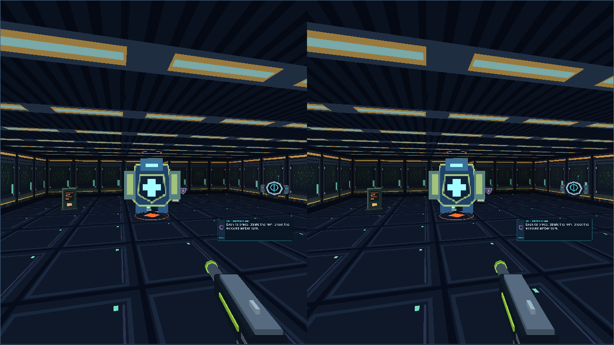

# Verification receipt — 0.9.0-rc.1

The candidate starts at merged main `89d9dc0795fd73e71176940721202091706a61c0`. Commands ran in this branch, with no production deployment. Node/Playwright are test tooling; runtime dependencies remain empty.

| Check | Observed result | Evidence |
| --- | --- | --- |
| `npm run check` | 86 JavaScript modules pass syntax checks | [command receipt](commands.txt) |
| `npm test` | 286/286 pass: previous 256 tests plus 28 focused Pit tests and two full campaign playthroughs | [Node output](node-tests.txt) |
| `npm run playtest` | Original twelve sectors and deliberate failure/retry pass | [original receipt](original-playthrough.json) |
| `npm run playtest:immersive` | Original twelve sectors through tracked rig and failure/retry pass | [tracked original receipt](original-immersive-playthrough.json) |
| `npm run playtest:pit` | All twelve trials and four three-phase guardian defeats in Classic and tracked play; save/restore after every trial | [campaign receipts](playthrough.json) |
| Production build and `verify-build.mjs` | 161 relative asset/import/cache references resolve | [command receipt](commands.txt) |
| `verify-offline.mjs` | 55 cached assets; navigation fallback/cache cleanup pass | [worker receipt](offline-check.json) |
| Existing production browser suite | Signal 17/17, WebGL 40/40, immersive 36/36, responsive UI 23/23, Arcade 22/22, Xbox 27/27, smoke and offline CODE BROWN pass | [browser report](regressions/browser-results.json) |
| Equipment comparison | 38 checks, 23 production captures, settings/behavior checks pass; zero live GL resources after each disposal | [equipment report](equipment/report.json) |
| Live Survival UI | Real fire/reload, finite reserve, no passive refill, dash shield, captions off, optional speech fallback and retained log pass | [Survival report](survival/survival-browser.json) |
| Production Pit browser | Both twelve-stage campaigns, real DOM start/continue/ending, independent original slot, disconnected Pit resume/restart; no page errors | [Pit browser report](browser.json) |
| Baseline preservation | Original sector/weapon registries equal, serialized initial Legacy save equal except release, old save without mode restores Legacy; 15 input/equipment/Gen.E/ΦWAD files byte-identical | [preservation receipt](preservation.json) |

The playthrough driver moves, fires, reloads, interacts, collects resources and reaches extraction through `Game`; immersive runs use `stepImmersive`/`ImmersiveRig`. It does not edit position, HP, ammo, enemy/objective flags or call completion/damage directly. It uses exact aim, map knowledge and fast exposed movement settings. Classic finished with 31 manual reloads, 25 shields and one Bash; tracked play used 31 reloads, 20 shields and three Bashes. Both retained actual final stage receipts and all boss phases. Live attack event details are in each report; a single winning run need not wait for every attack variant.

Hazard warning/damage/shield budgets and boss guard/counter/phase rules also have focused simulation fixtures. Those fixtures deliberately arrange positions and phase health to isolate behavior; they are not used for campaign-completion evidence. Three quality presets across all twelve maps fit existing batch capacity without state writes. This does not constitute on-device performance profiling.

## Captures and reproduction

Run the normal production build, then `node scripts/verify-pit-browser.mjs` with Playwright available externally. `BTM_PIT_OUTPUT` selects the evidence directory; `BTM_PLAYWRIGHT_MODULE` and `BTM_CHROMIUM_EXECUTABLE` select tooling. Set `BTM_SOFTWARE_WEBGL=1` for software graphics. Local verification used Chromium headless shell 151.0.7922.34 and software WebGL. It proves actual renderer output and browser behavior, not physical stereo comfort or frame rate.

[screenshots](screenshots/) contains real trial-entry views for all twelve stages in both native Canvas and synthetic stereo WebGL, guardian combat moments, menu/live Survival and the actual fully played ending. The driver freezes between steps while the actual renderers draw the real state. The capture camera follows the driver's pose; entry fade is omitted only for the stationary QA capture, without changing simulation state. Full gameplay state is never staged for these campaign captures. Layout Preview on `pit-qa.html` is explicitly separate and is not completion evidence.

The first Gatekeeper moment was obscured by a foreground captive. A [clear Gatekeeper replay](gatekeeper-replay.json) and its [actual driven checkpoint](gatekeeper-gameplay-frame.json) provide a readable view through production `Game.restore`; this supplemental image is a checkpoint replay, not an additional full-campaign pass.

The existing production browser suite also validates disconnected CODE BROWN, original controls, XR lifecycle/neutral rearm, aiming, wrists, resource disposal and responsive layout. Equipment comparisons use identical synthetic poses against the exact merged-main baseline. Failed development runs and repair notes remain under [failures](failures/README.md).

## Remaining acceptance

Physical Quest 3 frame timing, comfort, stereo perception, real Touch feel/haptics, device speech, thermals and standing/seated human play are **pending**. Human difficulty and finite-supply pacing across all four acts also need playtesting; perfect scripted aim is not a substitute. See the [physical acceptance checklist](quest3-acceptance.md). No result here is a physical-headset pass, and no merge or deployment is authorized by these receipts.

The equipment workflow now runs the Pit playthrough and production browser suite and uploads their captures alongside existing evidence. GitHub CI results belong to the actual PR head and must be checked there; this local receipt does not invent a remote CI result.
